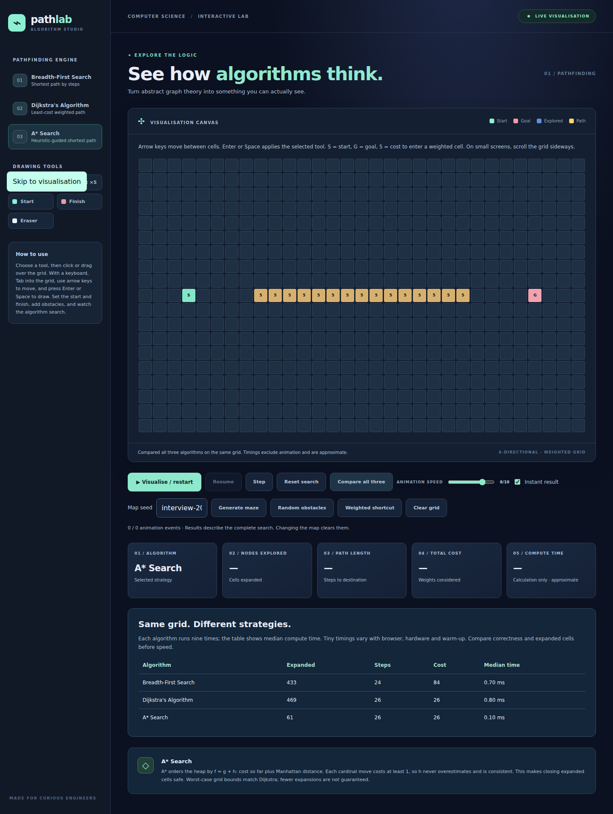

# PathLab

An interactive JavaScript laboratory for BFS, Dijkstra and A*: edit a weighted grid, reproduce a maze from its seed, and inspect how each search reaches its answer.

[**Open the live demo**](https://rudransh7.github.io/pathlab-pathfinding-visualiser/)

**Verified:** 17 Node tests passed, including 1,000 seeded maps checked against an independent Bellman–Ford oracle. GitHub Actions passes on Node 22/24 and Chromium; desktop/mobile screenshots were visually reviewed. See [the verification record](docs/VERIFICATION.md).



[Mobile screenshot](docs/images/mobile.png)

## Explore

- Draw walls or cost-5 terrain; move the start and goal.
- Run BFS, Dijkstra or A*, then pause, resume or step through expansions.
- Adjust playback speed or use instant results; reduced-motion preference starts in instant mode.
- Compare steps, weighted cost, expanded cells and approximate computation time on the same map.
- Generate reproducible random obstacles or connected mazes from a text seed.
- Use the keyboard: Tab enters the grid; arrow keys move focus; Enter/Space applies the selected tool; Home/End moves within a row.

BFS finds the fewest steps. It does **not** generally find the cheapest weighted path. Dijkstra and A* minimise total terrain cost. The weighted example makes this difference visible.

## Run locally

Use Node.js 22 or 24 and its bundled npm. There are no runtime or npm dependencies to install.

```bash
npm start
```

Open <http://127.0.0.1:8001>. The local server binds to loopback and serves only the app's fixed asset list. ES modules need an HTTP server; opening `index.html` directly from disk is not the documented workflow.

```bash
npm test
npm run check
npm run build
```

The build copies the six public assets into `dist/` for static hosting; it does not bundle a backend. `private: true` in package.json prevents accidental npm publication and does not control GitHub visibility.

### Optional browser checks

Use Python 3.12 or 3.13 in a virtual environment:

```bash
python3.12 -m venv .venv
source .venv/bin/activate
python -m pip install -r requirements-browser.txt
python -m playwright install chromium
python tests/browser_smoke.py
```

Ensure `node` is on PATH. The script starts the local server, exercises desktop/mobile interactions and writes screenshots to ignored `browser-artifacts/`. On Linux CI, install Chromium with `--with-deps`. [Verified successful run](https://github.com/Rudransh7/pathlab-pathfinding-visualiser/actions/runs/40079263821).

## Architecture

| File | Responsibility |
|---|---|
| `algorithms.js` | Validated graph model, BFS, stable heap, Dijkstra and A* |
| `maps.js` | Seeded PRNG, obstacle generation and iterative DFS maze carving |
| `playback.js` | Pure playback state and event sequence |
| `ui.js` | Grid input, rendering, controls and comparison metrics |
| `index.html`, `styles.css` | Semantic page structure, focus styles and responsive layout |
| `tests/` | Deterministic tests, independent oracle comparisons and browser smoke script |
| `scripts/` | Minimal local server and static deployment build |

The search functions do not depend on the DOM. They return `found`, `path`, `visitedOrder`, `visitedCount`, `steps` and `pathCost`. Cost excludes the starting cell; unreachable cost/steps are `null`. This separation makes computation testable independently of animation.

See [algorithm guarantees, complexity and trade-offs](docs/ALGORITHMS.md) and [ownership, interview questions and exercises](docs/OWNERSHIP.md).

## Testing and deployment

The Node test runner is sufficient; a test framework or frontend build system would add little here. CI passes on Node 22/24 plus a Chromium smoke job.

The Pages workflow is manually triggered and only deploys `main` after tests, syntax checks and build. Choose **GitHub Actions** as the Pages source in repository settings and run **Publish static demo**. The [live demo](https://rudransh7.github.io/pathlab-pathfinding-visualiser/) was deployed and browser-checked on 25 October 2026 ([deployment run](https://github.com/Rudransh7/pathlab-pathfinding-visualiser/actions/runs/40154293677)). The weighted example returned BFS: 24 steps / cost 84; Dijkstra and A*: 26 steps / cost 26. These are example results, not general performance guarantees.

## Limits and provenance

The visual grid is fixed at 19×31 and scrolls horizontally on small screens. Computation is synchronous; it is designed for this small teaching grid. Runtime figures are approximate, not benchmark claims. There are no accounts, analytics, remote data requests or private application records.

The original supplied version already contained all three algorithms, a heap, a basic grid and eight tests. Later correctness, usability, reproducibility and test improvements were developed with AI assistance. The original source is retained in repository history; dated commits document the subsequent review. See the ownership guide for the contribution boundary and personal exercises. No earlier development dates or performance achievements are inferred from the import commit.
